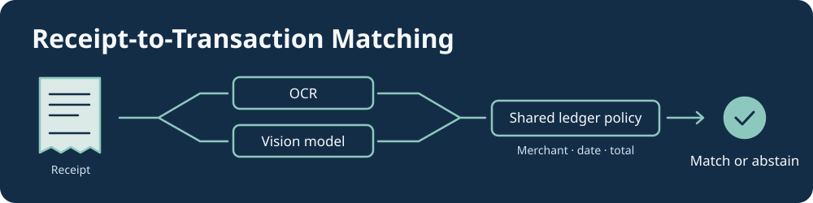
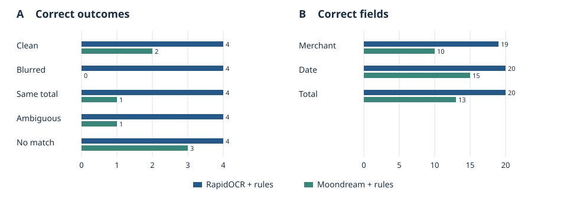
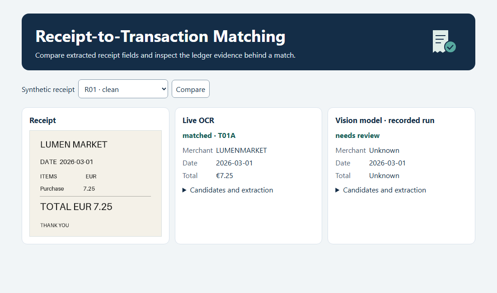

# Receipt-to-Transaction Matching



Match a photographed receipt to a ledger entry using its merchant, date, and total. This project compares RapidOCR with Moondream on 20 synthetic receipts. Both extractors use the same matching rules, and an ambiguous receipt stays unassigned.

## Results



| Extractor | Correct matches (12) | Correct outcomes (20) | Wrong assignments | Median extraction time |
| --- | ---: | ---: | ---: | ---: |
| RapidOCR | 12 | 20 | 0 | 647 ms |
| Moondream | 3 | 7 | 0 | 5,059 ms |

The OCR baseline matched all four blurred receipts and all four same-total receipts. The vision model matched one same-total receipt and none of the blurred receipts. Both avoided assigning any of the eight receipts that had no unique counterpart. Moondream often returned an incomplete extraction, which explains the difference between abstaining and returning the specific expected reason.

For example, **R01** lacked a merchant and total in the vision output, so it was sent to review. For **R13**, OCR recovered all three fields, but the ledger had two equally plausible candidates. The matcher surfaced both and withheld a decision. [OCR results](data/results-ocr.json) · [Vision results and raw transcripts](data/results-vision.json).

The benchmark uses four examples per scenario, all produced by one receipt template. The parser was adapted to common output forms, then the stored vision transcripts were rescored. These are exploratory results on synthetic images. The timing includes local inference and its startup costs. Vision timing reflects the original HTTP inference run and excludes the later rescore.

## Browser demo



```sh
python -m pip install -r requirements.txt
python app.py
```

Open [localhost:8766](http://127.0.0.1:8766/). Pick a receipt to run OCR live and compare it with Moondream's recorded result. The details panel exposes the extracted text and candidate scores. Try **R08** for the strongest blur, **R10** for a same-total purchase, and **R13** for an unresolved tie.

## Reproduce

```sh
python generate.py
python -m unittest -v
python evaluate.py ocr
ollama pull moondream
python evaluate.py vision
python render_benchmark.py
```

The vision benchmark uses a running local Ollama server. `OLLAMA_URL` defaults to `http://127.0.0.1:11434`, and `VISION_MODEL` defaults to `moondream`. To apply parser changes to previous outputs, run `python evaluate.py vision --rescore`. The browser demo can replay the committed model outputs without Ollama.

The matcher first filters ledger rows by exact date and integer cents. It then requires a merchant similarity of at least 0.85 and a lead of at least 0.12 over the next candidate. Missing or conflicting fields go to review. The evaluation uses the separate case manifest for scoring, while the matcher itself only sees extracted fields and the candidate ledger.
